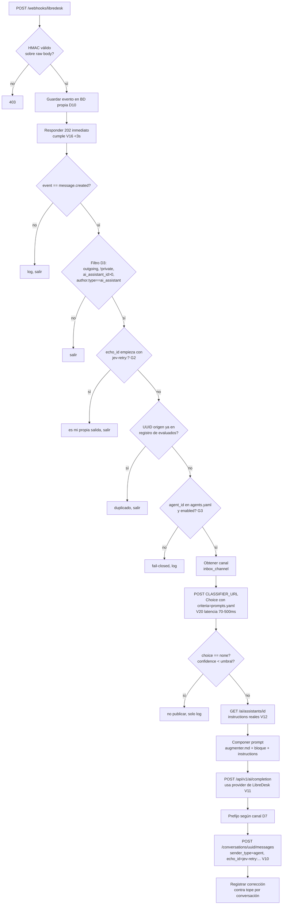

# FEATURE: JEV Enforcement Loop

## 1. Objetivo

Un webhook que observa cada mensaje publicado por un Agente IA de LibreDesk, lo clasifica con
JEV (TypeSafe), y —si corresponde— genera una respuesta mejorada usando el mismo proveedor de
IA configurado en LibreDesk, publicándola como mensaje adicional en la conversación.

No se borra nada. No se reasigna nada. El agente IA continúa al mando de la conversación.

## 2. Contexto verificado

Todas las afirmaciones de abajo fueron comprobadas en código o documentación, no supuestas.

| # | Hecho | Fuente |
|---|---|---|
| V1 | `message.created` llega con `meta.ai_assistant_id > 0` solo en respuestas de asistente IA | `libredesk/internal/aiagent/worker.go` → `postReply()` inyecta `meta["ai_assistant_id"] = assistant.ID` antes de `QueueReply` |
| V2 | El webhook se dispara **después** del refetch, así que el payload trae campos pobados (`author`, `media`) | `libredesk/internal/conversation/message.go` → `AfterMessageInsert()` llama `TriggerEvent(EventMessageCreated, message)` tras `GetMessage()` |
| V3 | Un asistente borrado sigue apareciendo como autor de mensajes viejos | `libredesk/internal/aiagent/queries.sql` → `get-assistant-user-ids`: *"Deleted assistants stay included: their old replies must still be recognized as AI-authored."* |
| V4 | El conteo de turnos filtra por `sender_id` del asistente → los mensajes de hub-api **no consumen turnos** | `queries.sql` → `count-ai-turns-since-assignment`: `WHERE ... sender_id = $2` |
| V5 | `max_turns` default 6, máximo 20; el handoff ocurre al superarlo | `aiagent.go` → `if a.MaxTurns <= 0 \|\| a.MaxTurns > 20 { a.MaxTurns = 6 }`; `worker.go` → `if turns >= assistant.MaxTurns { m.handoff(...) }` |
| V6 | El handoff asigna al team fallback y **luego** desasigna al usuario | `worker.go` → `UpdateConversationTeamAssignee(...)` seguido de `RemoveConversationAssignee(conv.UUID, AssigneeTypeUser, actor)` |
| V7 | Cualquier actividad `assigned_user_change` / `self_assign` **reinicia** el conteo de turnos | `queries.sql` → subconsulta `created_at > max(created_at) WHERE activity_type IN ('assigned_user_change','self_assign')` |
| V8 | El equipo NO distingue IA de humano; el disparador es `assigned_user_id` | `worker.go` → `m.GetAssistantByUserID(int(conv.AssignedUserID.Int))` |
| V9 | Tipos de usuario incluyen `ai_assistant` explícito | `libredesk/internal/user/models/models.go` → `UserTypeAIAssistant = "ai_assistant"` |
| V10 | `echo_id` existe en la API de envío de mensajes y se devuelve al emisor para deduplicación | docs LibreDesk → `POST /api/v1/conversations/{cuuid}/messages`, campo `echo_id` |
| V11 | `POST /api/v1/ai/completion` acepta `{prompt_key, content}` y devuelve `data: string` — usa el provider de Completion ya configurado | docs LibreDesk → AI Completion |
| V12 | `GET /api/v1/ai/assistants/{id}` devuelve `instructions`, `guardrails`, `tone`, `response_length`, `max_turns`, `enabled` | docs + `queries.sql` → `get-assistant` |
| V13 | El payload de `message.created` **NO incluye** `inbox_id` ni `inbox_channel` | docs LibreDesk → schema de `message.created` (solo `conversation_id`, `conversation_uuid`) |
| V14 | `conversation.created` SÍ incluye `inbox_channel` | docs LibreDesk → schema de `conversation.created` |
| V15 | LibreDesk **no reintenta nunca** y descarta eventos si la cola está llena | docs → "Failed deliveries are not retried", "Events are dropped when the delivery queue is full" |
| V16 | Entrega exige respuesta <3s (timeout default 15s) | docs → "verify the signature and reply within 3 seconds" |
| V17 | `timestamp` del envelope se genera con resolución de 1 segundo | `internal/webhook/webhook.go` → `"timestamp": time.Now().UTC().Format(time.RFC3339)` |
| V18 | JEV Choice devuelve UN `choice`, `probabilities` por opción y `confidence` de la elegida | docs.typesafe.ai/primitives/choice.md |
| V19 | `confidence` mide qué tan apuntada está la distribución, NO la probabilidad de la opción | choice.md → ejemplo real: `returns` prob 0.61 pero `confidence` 0.42 por ambigüedad entre dos equipos |
| V20 | Estructura de request JEV: `state`, `model`, `questions{id:{type,instructions,criteria}}` | choice.md → "Request structure" |
| V21 | `criteria` es mapa `{nombre → descripción}`, hasta 255 opciones, descripciones pueden ser `null` u objeto con campos libres | choice.md |
| V22 | Latencia reportada de JEV: 70–500 ms end-to-end | es.wikipedia.org/wiki/Jev_(modelo_de_IA) → Rendimiento |

## 3. Decisiones de diseño acordadas

### D1 — Un endpoint de ingesta, no uno por evento
`/webhooks/libredesk` maneja todos los eventos y despacha internamente por el campo `event`.

**Por qué:** LibreDesk envía todo a UNA URL fija por webhook configurado; el nombre del evento viaja
dentro del body. Enrutear por `/webhooks/{evento}` obligaría a crear N webhooks en Admin →
Integraciones → Webhooks, con el mismo payload repetido. No aporta nada.

La convención de rutas queda `/webhooks/{origen}` (una ruta por sistema que empuja eventos:
`libredesk`, y mañana otros). Cambiar `/hooks/libredesk` → `/webhooks/libredesk` es parte del trabajo.

### D2 — Cuándo NO actuar (tres guardas)

| Guarda | Regla | Base |
|---|---|---|
| **G1 — JEV dice no intervenir** | La acción `none` SIEMPRE debe existir en `prompts.yaml`. Acción ausente o inválida = `none` = no publicar, solo loggear | Requisito del usuario; V21 permite declararla como opción normal |
| **G2 — No reclasificar salida propia** | Todo mensaje publicado por hub-api lleva `echo_id: "jev-retry:<uuid-mensaje-origen>"`. Si un `message.created` trae ese prefijo, es nuestra propia salida → salir | V10 |
| **G3 — Solo agentes habilitados** | Allowlist explícita en `agents.yaml`. ID ausente = fail-closed (ignorar + log). `enabled: false` = ignorar silencioso. GET del agente falla (borrado) = ignorar + WARN | V3, V8, V9 |

`echo_id` cumple doble función: guarda G2 **y** llave natural del registro de "ya evaluado"
(no se necesita tabla separada).

### D3 — Filtro de entrada completo
Un mensaje entra al pipeline solo si **las cuatro condiciones** se cumplen:

```
payload.type == "outgoing"
AND payload.private == false
AND payload.meta.ai_assistant_id > 0
AND payload.author.type == "ai_assistant"
```

Se exigen las dos señales de IA (`meta.ai_assistant_id` y `author.type`) porque son independientes
y redundantes: la primera la pone `postReply()`, la segunda viene del tipo de usuario.

### D4 — Identidad de publicación
Hub-api publica con su **propio usuario**, no con el del asistente.

**Consecuencia verificada (V4):** los mensajes de hub-api NO cuentan en `count-ai-turns-since-assignment`,
así que esta feature **no acelera ni retrasa el handoff por `max_turns`**. El comportamiento existente queda intacto.

Si se publicara como el asistente, cada corrección consumiría 1 de los 6 turnos y además inflaría las
métricas de Performance del asistente (replies, CSAT y resolución cuentan por `sender_id` — `queries.sql` líneas 82, 88-92).

### D5 — Composición del prompt final
```
prompt final = contenido de prompt-augmenter.md
             + bloque de prompts.yaml[key elegido por JEV]
             + instructions reales del asistente (vía GET /api/v1/ai/assistants/{id}, V12)
```
Solo acciones existentes en el YAML. Acción ausente o inválida = `none`.

### D6 — LLM vía LibreDesk, no directo
Se usa `POST /api/v1/ai/completion` (V11). Hub-api **no** conoce base URL, model, temperature ni
max tokens del proveedor. Elimina duplicar configuración y mantiene la auditoría del lado de LibreDesk.

**Limitación aceptada:** ese endpoint recibe un único `content` plano, sin separar system/user roles.
Toda la composición viaja dentro de ese string.

### D7 — Prefijo según canal
| Canal | Texto |
|---|---|
| LiveChat, WhatsApp | `Pensando un poco mejor lo comentado... {respuesta}` |
| Email | `Para ser más precisos, o con otro punto de vista {respuesta}` |

El `>` del borrador original fue error de tipeo y se elimina (confirmado).

### D8 — Reglas precargadas en arranque
Todos los YAML se leen al subir. Cambiar una regla exige reiniciar el servicio. Se expone
versión/hash de reglas cargadas en `/meta/config` (protegido con API key), **no** en `/healthz`
(este último es probe sin auth del contenedor y debe seguir sin datos).

### D9 — Concurrencia con async de FastAPI
Reemplazar `threading.Thread(daemon=True)` por handlers `async` + `httpx.AsyncClient` +
`asyncio.Semaphore(N)`.

**Por qué:** FastAPI es asíncrono nativo. El costo real del pipeline es espera de red
(JEV 70–500 ms por V22; LLM 1–30 s), no CPU de Python. Threads ilimitados por evento introducen:
sin tope de concurrencia, muerte silenciosa de trabajos a medias al reiniciar (~8 MB de stack/hilo),
y riesgo de agotar cuotas del proveedor en ráfagas. Con `async` + semáforo, un worker sostiene
decenas de esperas concurrentes con control explícito.

**Python no es el cuello de botella.** El ajuste es de modelo de concurrencia, no de lenguaje.

### D10 — Persistencia del evento recibido
Antes de responder 202, guardar el evento en una tabla propia de hub-api.

**Por qué:** con "cero reintentos" (V15) y descartes por cola llena, si hub-api se cae durante un
reintento ese mensaje nunca se evalúa y no hay forma de saberlo. Este registro resuelve tres cosas
a la vez: auditoría, idempotencia duradera, y reprocesamiento de lo que quedó a medias.

## 4. Estructura de archivos propuesta

```
rules/
├── prompts.yaml          # acción JEV → texto system a inyectar (allowlist cerrada, incluye `none`)
├── agents.yaml           # agent_id → enabled + prefijos por canal
└── prompt-augmenter.md   # descriptor: cómo se compone el prompt final

app/
├── core/
│   ├── config.py         # + CLASSIFIER_URL, CLASSIFIER_API_KEY, CLASSIFIER_MODEL,
│   │                     #   CLASSIFIER_REASONING_EFFORT, CLASSIFIER_TEMPERATURE, CLASSIFIER_MAX_TOKENS
│   │                     #   + JEV_MIN_CONFIDENCE, JEV_MAX_CORRECTIONS, JEV_CONCURRENCY
│   └── rules.py          # NUEVO: carga en arranque + hash/versión de reglas
├── routers/
│   └── webhooks/
│       └── libredesk.py  # RENOMBRAR hooks.py; /hooks/libredesk → /webhooks/libredesk
└── jev/                  # NUEVO: pipeline de enforcement
    ├── intake.py         # guardas G1-G3, filtro D3, persistencia D10
    ├── classifier.py     # request JEV (state/model/questions), parseo de answers
    ├── composer.py       # aplica prompt-augmenter.md + bloque de prompts.yaml + instructions del agente
    ├── generator.py      # POST /api/v1/ai/completion
    └── publisher.py      # POST .../messages con echo_id + prefijo por canal
```

### Formato de `rules/prompts.yaml`
```yaml
options:
  none: "Ninguna de las acciones aplica. El mensaje del agente es adecuado tal como está."
  ask-technological-stack: "Debes preguntar, con mucha cortesía, sobre el STACK deseado (PHP, HTML, PYTHON, JAVA)"
  ask-architecture: "Debes preguntar, con mucha cortesía, sobre la arquitectura deseada BACKEND/MOBILE"
  close-forward-human: "Debes resumir lo conversado, anunciar la entrada del ESPECIALISTA COMERCIAL, o si lo prefiere, agendar la reunión técnica con el Arquitecto. Luego debes hacer el HANDOFF"
```
Las claves de `options:` son los KEYS que se usan en la composición y se mapean directo a
`criteria` de JEV (V20, V21) — misma forma `{nombre → descripción}`, sin transformación.

### Formato de `rules/agents.yaml`
```yaml
agents:
  7:
    enabled: true
    prefixes:
      chat:  "Pensando un poco mejor lo comentado..."
      email: "Para ser más precisos, o con otro punto de vista"
  9:
    enabled: false
```

Separado de `prompts.yaml` porque los agentes y las acciones son dimensiones distintas:
meter el ID de agente dentro de cada acción obligaría a duplicar todas las acciones por agente
(3 agentes × 6 acciones = 18 entradas que se desincronizan).

## 5. Flujo del pipeline



## 6. Tareas accionables

### Fase 1 — Reorganización de rutas (prerrequisito)
- [ ] T1.1 Crear `app/routers/webhooks/` y mover `hooks.py` → `webhooks/libredesk.py`
- [ ] T1.2 Cambiar prefix del router `/hooks` → `/webhooks` (endpoint resultante: `POST /webhooks/libredesk`)
- [ ] T1.3 Actualizar `app/main.py` (`include_router`) y cualquier referencia en `.env.example` / docs internas
- [ ] T1.4 Verificar que ningún handler dependa de la ruta anterior (ninguno lo hace: el despacho es por `body.event`)

### Fase 2 — Carga de reglas
- [ ] T2.1 Crear `rules/prompts.yaml` con `none` incluido como opción obligatoria
- [ ] T2.2 Crear `rules/agents.yaml` con estructura allowlist
- [ ] T2.3 Crear `rules/prompt-augmenter.md` (plantilla de composición)
- [ ] T2.4 Implementar `app/core/rules.py`: lectura en arranque, validación de esquema, cálculo de hash
- [ ] T2.5 Rechazar el arranque si un YAML está mal formado (consistente con el fail-closed de `config.py`)
- [ ] T2.6 Exponer hash/versión de reglas en `/meta/config` (dejar `/healthz` limpio)

### Fase 3 — Configuración
- [ ] T3.1 Agregar a `Settings`: `CLASSIFIER_URL`, `CLASSIFIER_API_KEY`, `CLASSIFIER_MODEL`, `CLASSIFIER_REASONING_EFFORT`, `CLASSIFIER_TEMPERATURE`, `CLASSIFIER_MAX_TOKENS`
- [ ] T3.2 Agregar controles de negocio: `JEV_MIN_CONFIDENCE`, `JEV_MAX_CORRECTIONS`, `JEV_CONCURRENCY`
- [ ] T3.3 Validadores fail-closed coherentes con `_validate_key` / `_validate_allowlist` existentes
- [ ] T3.4 Documentar variables en `.env.example`

### Fase 4 — Guardas y estado
- [ ] T4.1 Crear tabla propia de hub-api para eventos recibidos (auditoría + idempotencia + reproceso)
- [ ] T4.2 Implementar guardas G1/G2/G3 en `jev/intake.py`
- [ ] T4.3 Implementar filtro D3 (cuatro condiciones)
- [ ] T4.4 Migrar dedupe de `_seen` en RAM al registro persistente (resuelve también V17: timestamp de 1 segundo)
- [ ] T4.5 Tope de correcciones por conversación

### Fase 5 — Pipeline JEV
- [ ] T5.1 `jev/classifier.py`: armar request `{state, model, questions}` con `criteria` desde `prompts.yaml`
- [ ] T5.2 Parsear `answers.<id>.{choice, confidence, probabilities}` (V18)
- [ ] T5.3 Umbral sobre `confidence`, **no** sobre `probabilities` (V19 — son ejes distintos)
- [ ] T5.4 Decisión top-1 (ver Open Question O3)
- [ ] T5.5 Manejar error de red / timeout del clasificador: no publicar, loggear

### Fase 6 — Generación y publicación
- [ ] T6.1 Cliente `GET /api/v1/ai/assistants/{id}` para obtener `instructions` del agente (V12)
- [ ] T6.2 Cache de esa config por `agent_id` (invalidar al reiniciar, coherente con D8)
- [ ] T6.3 `jev/composer.py`: aplicar `prompt-augmenter.md` + bloque de acción + instructions
- [ ] T6.4 `jev/generator.py`: `POST /api/v1/ai/completion` con `prompt_key` + `content` (V11)
- [ ] T6.5 Resolver canal → prefijo de `agents.yaml` (D7)
- [ ] T6.6 `jev/publisher.py`: `POST /conversations/{uuid}/messages` con `sender_type=agent`, `echo_id=jev-retry:<uuid>` (V10)
- [ ] T6.7 Para email: verificar `content_type` y escapado (el contenido pasa por plantillas HTML)

### Fase 7 — Eliminar `threading.Thread` (no es opcional ni cosmético)

**Qué se quita exactamente.** Hoy, en `receive_webhook`, cada evento aceptado lanza un hilo nuevo:

```python
threading.Thread(target=_dispatch, args=(event_name, body), daemon=True).start()
```

Y `_dispatch` invoca a los handlers de forma síncrona dentro de ese hilo. El reemplazo es ejecutar el
despacho como tarea asíncrona sobre el event loop de FastAPI, con `httpx.AsyncClient` para todas las
llamadas salientes (JEV, `/api/v1/ai/*`) y un `asyncio.Semaphore` como tope global.

**Por qué hay que quitarlo — cuatro razones concretas:**

1. **No tiene tope de concurrencia.** Un hilo por evento significa que una ráfaga (importación de
   correos, rebote de un servicio, campaña) crea N hilos simultáneos, cada uno abriendo su propia
   conexión HTTP al LLM, sin nada que lo frene. Con esta feature el problema se agrava: cada mensaje
   del agente IA dispara JEV + un `POST /api/v1/ai/completion` que tarda segundos. Ráfagas de mensajes
   del agente son la norma, no la excepción.

2. **Los trabajos mueren en silencio.** Son hilos `daemon=True`: cuando el proceso termina (deploy,
   reinicio, OOM), Python no los espera ni avisa. Un reintento a mitad de la llamada al LLM desaparece
   sin dejar rastro. Con latencias de 1–30 s por generación, siempre hay trabajos a medias en un
   despliegue. Choca directo con V15: LibreDesk no reintenta nunca, así que ese evento perdido no
   vuelve a llegar jamás.

3. **Costo de memoria por espera ociosa.** Cada hilo reserva ~8 MB de stack; 200 hilos concurrentes
   son ~1.6 GB de memoria virtual gastada en esperar red. El trabajo real de CPU (verificar HMAC,
   parsear JSON de 2–10 KB) es de microsegundos; todo lo demás es I/O. Los threads son la herramienta
   equivocada para carga dominada por I/O.

4. **Desperdicia lo que FastAPI ya da gratis.** FastAPI es asíncrono de nacimiento. Un solo worker con
   `async def` sostiene decenas de esperas concurrentes sin crear un hilo por evento, y el `Semaphore`
   permite limitar reintentos simultáneos de forma explícita y medible. Manteniendo threads, ese
   control queda del lado del SO.

**Aclaración para quien implemente:** esto NO es un cambio de lenguaje ni de framework, y Python no era
el cuello de botella. Es un cambio de *modelo de concurrencia*. El costo del pipeline sigue dominado por
la red (JEV 70–500 ms por V22; LLM 1–30 s), no por el runtime.

**Restricción que no se toca.** El 202 debe seguir respondiéndose ANTES de cualquier llamada lenta
(V16 exige <3s). Pasar a `async` no autoriza a hacer el handler esperado: lo único que puede ir antes
del 202 es la persistencia del evento (D10), que es un INSERT local barato.
- [ ] T7.1 Crear un `httpx.AsyncClient` compartido en `lifespan` de `app/main.py` (no uno por request) y cerrarlo al apagar
- [ ] T7.2 Convertir los handlers del registry `HANDLERS` a `async def`; `_dispatch` pasa a ser coroutine con `await` secuencial por handler
- [ ] T7.3 **Eliminar** `threading.Thread(target=_dispatch, ..., daemon=True).start()` de `receive_webhook` y reemplazarlo por despacho asíncrono bajo `Semaphore`
- [ ] T7.4 Aplicar `asyncio.Semaphore(JEV_CONCURRENCY)` alrededor del pipeline completo (JEV + generación + publicación), no solo del paso lento individual
- [ ] T7.5 Confirmar que el 202 se responde ANTES de cualquier llamada lenta (V16): lo único permitido antes es el INSERT de D10
- [ ] T7.6 Verificar que ningún handler restante use bloqueo síncrono (llamadas `requests`, `psycopg` en hilo de event loop); si existe, envolver o migrar

### Fase 8 — Pruebas (aprovechando la instancia de desarrollo)
- [ ] T8.1 Usar el botón **Send test** de LibreDesk → evento `webhook.test`
      ⚠️ Su payload es solo `{id, name}` (verificado en `webhook.go` → `SendTestWebhook`). Hoy eso produce
      clave de dedupe `webhook.test|<ts>|` **idéntica para todas las pruebas**, y dos pruebas en el mismo
      segundo hacen que la segunda se descarte en silencio. Esto limita la capacidad de probar.
- [ ] T8.2 Prueba de bucle: confirmar que un mensaje publicado por hub-api NO reentra al pipeline
- [ ] T8.3 Prueba de turnos: verificar empíricamente que tras N correcciones de hub-api el handoff por
      `max_turns` sigue disparándose igual que sin hub-api (valida D4 contra V4/V5)
- [ ] T8.4 Prueba de reinicio: matar el proceso a mitad de un reintento y comprobar que el evento persistido
      puede reprocesarse (valida D10)
- [ ] T8.5 Prueba por canal: mismo caso en livechat, WhatsApp y email → prefijos correctos
- [ ] T8.6 Prueba fail-closed: agente ID no declarado en `agents.yaml` → no se toca nada

## 7. Riesgos identificados

| # | Riesgo | Severidad | Mitigación |
|---|---|---|---|
| R1 | Sin tope de reintentos concurrentes, una ráfaga agota cuotas del proveedor o derriba LibreDesk | Alta | T7.3 `Semaphore` |
| R2 | Trabajos a medios perdidos en deploy/reinicio, sin registro | Alta | D10 + T8.4 |
| R3 | Dedupe actual ineffective: `_seen` en RAM, se pierde al reiniciar, no funciona con >1 réplica | Alta | T4.4 |
| R4 | Colisión de clave de dedupe por timestamp de 1 segundo (V17) | Media | Pasar a `echo_id`/UUID como llave (D2) |
| R5 | Coste recurrente: JEV + LLM por **cada** turno del agente. Una conversación de 6 turnos = 6 evaluaciones | Media | `JEV_MIN_CONFIDENCE`, tope por conversación, acción `none` |
| R6 | Escribir directo en tablas de LibreDesk (`db.py`) se rompe con migraciones | Media | Definir política explícita: ¿solo lectura? Esta feature no requiere escritura directa — usar API |
| R7 | `POST /api/v1/ai/completion` no separa system/user roles | Baja | Aceptado en D6. Si se necesita control fino, revisar después |
| R8 | Config del asistente cambia en LibreDesk y hub-api sirve prompt viejo (cache) | Baja | Invalidación al reiniciar, coherente con D8 |
| R9 | El texto de tu corrección compite con el prompt original del agente en turnos siguientes | Baja | Deseado: el agente ve tu mensaje en su historial y no repregunta |

## 8. Open Questions (requieren decisión antes de implementar)

- **O1 — ¿Qué va en `state` de JEV?** El último mensaje del contacto, la conversación completa, o el
  borrador del agente. Define coste de tokens y qué se clasifica realmente. *Sugerencia: mensaje del
  contacto + historial reciente.*
- **O2 — ¿Umbral de confianza inicial?** V19 muestra que `confidence` 0.42 es un caso legítimo de
  distribución dividida. *Sugerencia: 0.7, configurable.*
- **O3 — Top-1 o multi-selección?** JEV elige UNA opción (V18). Para varias acciones hay que recorrer
  `probabilities` e implementar la selección en código propio. *Sugerencia: top-1; mezclar
  "pregunta el stack" + "cierra y pasa a humano" puede contradecirse en un solo prompt.*
- **O4 — ¿`prompt_key` para `/api/v1/ai/completion`?** Hay que registrar un Editor prompt en
  Admin → AI → Editor prompts y usar su `key`. Falta definir cuál.
- **O5 — Tope de correcciones por conversación.** *Sugerencia: 3.*
- **O6 — ¿Usar Companion Noul?** El doc de TypeSafe recomienda emparejar el Choice con un Noul
  ("¿alguna acción aplica?") cuando `none of the above` puede funcionar mal. Casi gratis (preguntas
  en paralelo, una pasada). *Sugerencia: dejarlo como mejora posterior, no en el MVP.*

## 9. Fuera de alcance

Explícitamente NO incluye:

- Borrar o editar mensajes del agente (decidido: nada se borra).
- Cambiar asignación de la conversación. El handoff al team lo hace LibreDesk (V6) o el tope de turnos (V5).
- Desasignar al agente IA tras corregir. El ciclo acordado es cliente → IA → corrección → cliente → IA, indefinido.
- Recarga en caliente de reglas. Cambio de YAML exige reinicio (D8).
- Multiplica de réplicas / Redis. Si se escala, T4.4 se vuelve obligatorio.
- Modificación de ninguna fuente en el repo de LibreDesk (es solo referencia de lectura).
