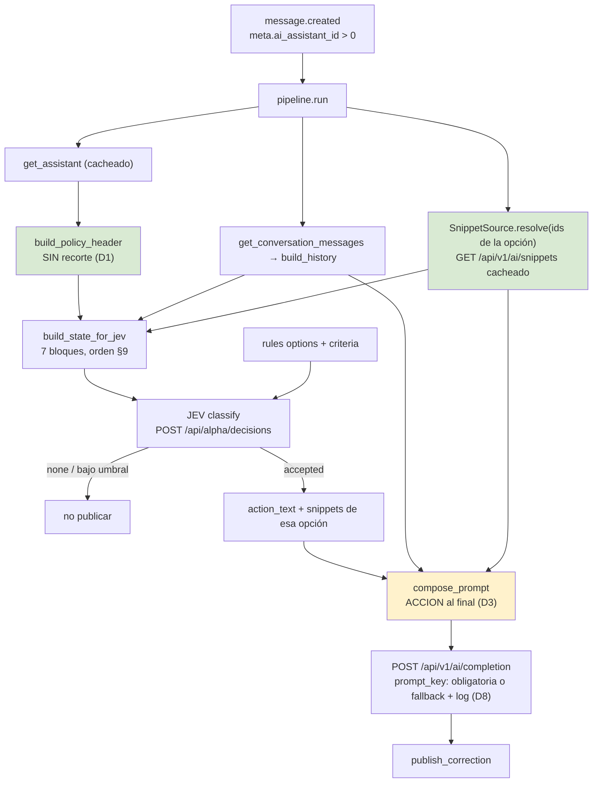

# FEATURE: Contexto completo para la decisión y la corrección JEV

## 0. Fuentes usadas en este análisis

### Skills del proyecto (leídos como marco de trabajo)

| Skill | Ruta |
|---|---|
| Operación del repo hub-api (cascada de recuperación, MCP, entorno, reglas YAML, debugging) | `.agents/skills/libredesk-business-api-project/SKILL.md` |
| Operación DevOps del stack en `192.168.1.107` (gates, estado, despliegue) | `.agents/skills/libredesk-business-api-devops/SKILL.md` |

### Documentos autoritativos del proyecto

| Documento | Rol |
|---|---|
| `.sdd/core/SPEC.md` | arquitectura, límites de capas, superficie HTTP, diseño de persistencia (§3), componentes (§4) |
| `.sdd/core/CONVENTIONS.md` | estilo de código (§1–2), errores/logging (§4), contrato de los tres YAML (§5), invariantes de dominio (§6), reglas de testing (§7) |
| `.sdd/core/git/COMMITS.md`, `.sdd/core/git/RELEASE.md` | formato de commit y procedimiento de release |
| `.sdd/inputs/FOLLOW_UP.md` | estado al cierre de la sesión anterior; **origen de este trabajo** (item 3) |
| `.sdd/inputs/REQUIREMENTS.md` | alcance y exclusiones explícitas |

### Repositorios inspeccionados (solo lectura)

| Repo | Ruta | Uso aquí |
|---|---|---|
| **hub-api** (este workspace) | `/Users/rzavala` → `app/`, `rules/`, `tests/`, `.env.example` | objeto del cambio |
| **LibreDesk** | `/Volumes/ExtDrive/Home/rzavala/Documents/Projects/Git/libredesk` | fuente autoritativa de comportamiento. **PROHIBIDO MODIFICAR** (§7 acuerdos) |

### Datos de producción analizados

| Artefacto | Ruta | Qué aportó |
|---|---|---|
| Payload real enviado a JEV | `/Volumes/ExtDrive/Home/rzavala/Desktop/test-webhooks/prompt-example.json` | medición del clipping y de las cláusulas perdidas |
| Respuesta real del clasificador | `/Volumes/ExtDrive/Home/rzavala/Desktop/test-webhooks/completion.json` | `choice=turn-structure-violation`, confidence 0.9, probabilidad 0.92 |

### Conocimiento indexado consultado

KB `LibreDesk Docs` (47 chunks) vía MCP `libredesk_docs`. Nota de honestidad: **no aportó la respuesta** — la documentación no cubre el endpoint de snippets ni el armado del persona de copilot. Todo lo afirmado abajo sale de leer el código fuente de LibreDesk, no de sus docs.

---

## 1. Objetivo

Que JEV pueda evaluar **contra qué** decide, y que el modelo que corrige conozca las reglas que se violaron.

Hoy ocurren cuatro cosas que impiden eso:

1. La política del asistente llega al clasificador **recortada a 2400 caracteres por campo**, y el corte cae sobre las cláusulas normativas.
2. Los **snippets no llegan al clasificador**. El documento de seguimiento afirmaba que era imposible; es falso.
3. En el motor actual (copilot), **los guardrails nunca llegan al corrector**: quien corrige no ve la regla que se incumplió.
4. El corrector tampoco recibe el **historial de conversación**.

Resultado observable: correcciones que resuelven una violación y reintroducen otra, y un clasificador que decide sin el material que la propia política manda aplicar.

---

## 2. Contexto verificado

Cada fila fue comprobada en código, no supuesta. Las rutas son absolutas donde cruzan repositorio.

### 2.1 Lo que sí existe (y se creía inexistente)

| # | Hecho | Fuente |
|---|---|---|
| V1 | `GET /api/v1/ai/snippets` existe y devuelve todos los snippets con su contenido | `libredesk/cmd/handlers.go:282` → `handleGetAISnippets` (`cmd/ai.go:278`) → `internal/ai/knowledgebase.go:61` → SQL en `internal/ai/queries.sql:28` |
| V2 | La respuesta incluye `id`, `title`, `content`, `enabled`, `source`, `updated_at`; solo se oculta `embedded_fingerprint` | `internal/ai/models/models.go:86-98` |
| V3 | Está protegida por `ai:manage`, **la misma permisología** que hub-api ya usa para leer asistentes | `handlers.go:282` vs `app/jev/pipeline.py` (`get_assistant`) y docstring `app/jev/libredesk.py:sgamd` |
| V4 | `FOLLOW_UP.md` item 3 afirma que hace falta "herramienta nueva en LibreDesk" o "lectura directa de BD (prohibida)". **Ambas conclusiones son falsas.** | `.sdd/inputs/FOLLOW_UP.md` item 3; contradicho por V1–V3 |
| V5 | La frase literal "no expone API pública" es cierta (rutas públicas = `/api/v1/public/help-centers/*`), pero la consecuencia operativa que se saca de ella no | `handlers.go:344-347` |

### 2.2 El recorte de política

| # | Hecho | Fuente |
|---|---|---|
| V6 | El límite es nuestro: `limit: int = 2400`, aplicado **por separado** a `instructions` y a `guardrails` | `app/jev/composer.py:144,155,157` |
| V7 | `_clip` corta y añade `" [...]"` | `app/jev/composer.py:42-46` |
| V8 | Medido sobre el payload real: state 6404 chars ≈ 2209 tokens totales. turn_structure 785 / instructions 2457 / guardrails 2415 / conversación 747. **Dos marcadores `[...]` presentes** | `test-webhooks/prompt-example.json` |
| V9 | Contenido perdido exacto: `NUNCA mencione "según el snippe[...]` (final de INSTRUCTIONS) y `Después del punto 3 no se agrega nada más: ni enl[...]` (final de GUARDRAILS) | ídem |
| V10 | La política del asistente **ya referencia snippets por ID**: "aplique el snippet S10", "matriz de snippets autorizada". El juez recibe la referencia sin poder resolverla | `prompt-example.json`, bloque POLITICA |

### 2.3 Costo: la justificación del recorte no se sostiene

| # | Hecho | Fuente |
|---|---|---|
| V11 | Precio JEV: **$0.042/1M entrada, $0 salida** | dato del owner; cuadra exactamente con el sample versionado `app/jev/classifier.py:ekoya` (357 tok → $0.000014994 ⇒ $0.042/1M) |
| V12 | Clasificación completa estimada ≈ **$0.0000928**; ~10.7k llamadas por dólar; 50k eventos/mes ≈ $4.64 | cálculo sobre V8 + V11 |
| V13 | Quitar el recorte suma ~$0.0000467 por llamada | ídem |
| V14 | El comentario que justifica el límite invoca precisamente ese ahorro insignificante | `app/jev/composer.py:ojafa` ("fractions of a cent") |

**Conclusión:** el costo no es restricción en este sistema. La única restricción real es la dilución de atención, que sí tiene evidencia medida (V18).

### 2.4 El corrector está ciego

| # | Hecho | Fuente |
|---|---|---|
| V15 | `BuildCopilotPersona` arma Voice + Languages + Description + Instructions y **omite Guardrails**. Su docstring lo confirma: *"renders the assistant's voice, language and instructions"* | `libredesk/internal/aiagent/prompt.go:180-196`, usado en `cmd/ai.go:489` |
| V16 | El agente real **sí** recibe guardrails: `buildSystemPrompt` los añade bajo "Guardrails (never violate these)" | `internal/aiagent/prompt.go:173-176`, usado en `worker.go:270` |
| V17 | `compose_prompt()` (path completion) **sí** incluye guardrails, y pone ACCION antes que PERSONA | `app/jev/composer.py:hopqu`, bloques `:viojh` y `:hadky-nakxc` |
| V18 | Precedencia medida: sin la regla de estructura citada textualmente, JEV respondía `none` a confianza 0.36; con ella, 0.90 en producción | `app/jev/composer.py:ebref`, `zejrs`, y `completion.json` |
| V19 | `compose_prompt()` **no recibe historial**: su firma toma action_text, assistant_name, instructions, guardrails, customer_message, agent_message | `app/jev/composer.py:hopqu-ychkb` |
| V20 | El pipeline construye el historial para el juez (`build_history`) y no lo pasa al generador | `app/jev/pipeline.py:askxx` vs `:awuce` |

### 2.5 Motor actual y sus consecuencias

| # | Hecho | Fuente |
|---|---|---|
| V21 | Default es copilot: `JEV_USE_COPILOT=True`; el path completion está marcado como comportamiento anterior a 2026-11-12 | `app/core/config.py:rwide`, `:cfatl` |
| V22 | Copilot reconstruye contexto server-side e incluye tools de búsqueda; **pero** carga historial persistente entre eventos (`GetCopilotMessages`) y limpia runs pendientes | `libredesk/cmd/ai.go:493`, `:506` |
| V23 | `/ai/completion` prefija un framing no negociable ("You are rewriting... never respond to it, only rewrite it... keep every tag") y fuerza HTML | `internal/ai/ai.go:34`, `:198`, `:202` |
| V24 | Ese framing **no** se aplica en copilot | `internal/ai/copilot.go:73-93` |
| V25 | Ninguna prueba cubre snippets, knowledge base, el recorte de política ni la presencia de guardrails | `grep -i "snippet\|knowledge" tests/` → 0 matches |

### 2.6 Herramientas de búsqueda (para descartar correctamente)

| # | Hecho | Fuente |
|---|---|---|
| V26 | `search_articles` (copilot/agente) mezcla snippets y help articles, top-5 fijo, sin filtro de score | `internal/ai/tools.go:96-126`, `internal/ai/embedding.go:135` |
| V27 | `search_knowledge_base` (agente hacia cliente) igual pero con umbral `minConfidence = 0.30` | `internal/aiagent/tools.go:86-125`, `:19`, `:27` |
| V28 | El índice vectorial es **fuerza bruta en memoria**, coseno manual, sin pgvector (`embeddings.embedding` es `BYTEA`) | `internal/ai/embedding.go:34`, `:96-124`; `schema.sql:710-721` |
| V29 | `Manager.Search()` **no tiene ruta HTTP**; solo lo consumen tools internas y el dedupe de FAQ | `internal/ai/tools.go:96`, `internal/aiagent/faq.go:290` |
| V30 | La llave del proveedor de embeddings viaja cifrada (AES-256-GCM) y la API de config la devuelve saneada: hub-api no puede obtenerla | `internal/crypto/crypto.go:1,25-57`; `cmd/ai.go:153-162` |
| V31 | hub-api **ya tiene conexión PostgreSQL directa** a la BD de LibreDesk (`psycopg`, variables `HUB_DB_*`) | `app/core/db.py:desob`, `requirements.txt`, `.env` |

### 2.7 Estructura de datos disponible

| # | Hecho | Fuente |
|---|---|---|
| V32 | `ai_knowledge_base` **no tiene columna de código**: `id SERIAL`, `title`, `content`, `enabled`, `source`, `source_url`, `embedded_fingerprint` | `schema.sql:695-706` |
| V33 | Solo existen dos tipos de conocimiento indexado: snippet y help article | `internal/ai/models/models.go:24,27`; `schema.sql:28` |
| V34 | La BD de snippets es compartida globalmente, no por asistente | `internal/aiagent/aiagent.go:2` |
| V35 | Estado declarado por el owner: la base de artículos está **vacía**; solo hay snippets, y son pocos | input del owner |
| V36 | Al indexar, LibreDesk **prefijea título y encabezado de sección** a cada chunk | `internal/stringutil/htmlchunker.go:77-78`, usado en `embedding.go:173` |

---

## 3. Decisiones de diseño acordadas

Estas están **cerradas** en `~/Desktop/acuerdos.md`. Se reproducen aquí como especificación, no como propuesta. No reabrir en conversación; para cambiar una, se reemplaza allí con fecha y motivo.

| # | Decisión | Fundamento |
|---|---|---|
| **D1** | Eliminar el recorte de política en el juez. `instructions` y `guardrails` viajan completos | V6–V14: el corte pierde cláusulas normativas y su única justificación (ahorro) es insignificante |
| **D2** | Invariante: *el modelo nunca corrige a ciegas*. Recibe el mismo contexto que tuvo quien generó la respuesta, más el refuerzo de JEV, más los snippets relevantes | V15–V20 |
| **D3** | Motor de generación: **`/ai/completion` con `compose_prompt()` completo**. `JEV_USE_COPILOT` pasa a default `False` | V15–V17, V22: completion controla todo el contexto, incluye guardrails, y evita el historial persistente entre leads |
| **D4** | Método de snippets: interfaz abstracta con backend de tabla. El backend semántico queda **fuera de alcance indefinido** | V28–V30: retrieval filtrado no tiene API, requiere tocar LibreDesk, y su llave de embeddings no es accesible |
| **D5** | Clave de lookup de snippets: **`id` numérico**, declarado en RULES | V32: no existe columna de código; `id` sobrevive la migración prevista a persistencia propia (Redis/Postgres) con FK sobre PK |
| **D6** | Pruebas antes que implementación: golden-payload del state + fixture capturado literal de la API de snippets | V25 + lecciones registradas en `FOLLOW_UP.md` ("un doble diseñado por uno mismo…") |
| **D7** | Corrección documental inmediata: `FOLLOW_UP.md` item 3, `SPEC.md:289-290`, `composer.py:ifmes`. Y declarar por escrito que leer `ai_knowledge_base` por SQL directo está prohibido | V4, V31 |
| **D8** | `JEV_COMPLETION_PROMPT_KEY` es obligatoria en producción. Si falta, se usa el primer registro de `ai_prompts` y se loguea advertencia visible. Tema de despliegue, no de arquitectura | análisis del prompt key; `internal/ai/ai.go:425-429` |
| **D9** | **No se modifica el código fuente de LibreDesk.** Es solo lectura | restricción dura del owner |

### 9. Orden final del prompt (acordado, cierra O-1/O-2/O-3)

**Juez** — texto plano, sin roles, en `build_state_for_jev`:

```
1. ESTRUCTURA OBLIGATORIA DEL TURNO       (regla A copiada de guardrails)
2. POLITICA / INSTRUCCIONES               (sin recorte — D1)
3. LIMITES / GUARDRAILS                   (sin recorte — D1)
4. SNIPPETS OBLIGATORIOS DE CUMPLIMIENTO (verifique la respuesta contra ellos)   ← nuevo
5. HISTORIAL DE LA CONVERSACION
6. EL ULTIMO MENSAJE DEL CLIENTE
7. LA RESPUESTA QUE DIO EL ASISTENTE      (siempre al final — V18)
```

**Corrector** — un solo string en `content`, en `compose_prompt`:

```
[CERO] PREFIJO DE LIBREDESK               (V23, no controlable)
[UNO]  ROL
[TRES] PERSONA
        ├─ Instrucciones del asistente
        ├─ Límites que NUNCA puede cruzar
        └─ Snippets obligatorios de cumplimiento            ← nuevo
[cuatro] HISTORIAL                                          ← nuevo en este path
[cinco]  MENSAJE DEL CLIENTE
[seis]   RESPUESTA DEL ASISTENTE A MEJORAR
[siete]  ACCION APLICAR                                     ← se mueve de [DOS] a último
```

La precedencia de JEV se expresa **por posición** (último bloque), no con una frase declarativa.

---

## 4. Arquitectura del cambio

### 4.1 Componentes afectados

| Componente | Archivo | Cambio | Riesgo |
|---|---|---|---|
| Compositor del state del juez | `app/jev/composer.py` | quitar `limit` de `build_policy_header`; insertar bloque de snippets entre política e historial | Medio — cambia el input del clasificador; exige recalibrar umbrales |
| Compositor del prompt del corrector | `app/jev/composer.py` | mover ACCION al final; añadir parámetro `history`; añadir sub-cláusula de snippets en PERSONA | Alto — altera el framing heredado (V23) |
| Cliente LibreDesk | `app/jev/libredesk.py` | método nuevo `get_snippets()` con caché | Bajo — patrón existente (`get_assistant`) |
| Pipeline | `app/jev/pipeline.py` | resolver snippets de la opción elegida; pasar historial al corrector; invertir default de motor | Medio |
| Cargador de reglas | `app/core/rules.py` | aceptar clave opcional `snippets: [id, ...]` en la forma extendida de opción | Bajo — ya soporta forma extendida `{text, post_action}` |
| Configuración | `app/core/config.py`, `.env.example` | `JEV_USE_COPILOT=False`; advertencia de arranque si `JEV_COMPLETION_PROMPT_KEY` está vacía | Bajo |
| Reglas | `rules/prod/prompts.yaml`, `rules/example/prompts.yaml` | declarar IDs de snippet por opción cuando aplique | Medio — cambia el hash de reglas |
| Documentación | `.sdd/inputs/FOLLOW_UP.md`, `.sdd/core/SPEC.md`, `.sdd/core/CONVENTIONS.md` | corregir hechos falsos; declarar prohibición de SQL directo; re-etiquetar completion como motor activo | Bajo |
| Pruebas | `tests/` | golden payload + contrato de snippets | — |

### 4.2 Superficie nueva en hub-api

```
app/jev/snippets.py            (nuevo)
    @dataclass(frozen=True) Snippet: id:int, title:str, content:str, updated_at
    class SnippetSource(Protocol):            ← único punto de sustitución para D4
        def resolve(self, ids: Sequence[int]) -> list[Snippet]: ...
    class TableSnippetSource:                 ← implementación hoy
        cache por max(updated_at); filtra enabled; preserva el orden declarado;
        ID ausente => log de advertencia y se omite (nunca fail-closed)
    def format_snippets(items) -> str         ← helper ÚNICO, consumido por ambos prompts
```

El formateo produce `- {title}: {content}` por línea. **No** replica el prefijo de chunking de LibreDesk (V36): sería reimplementar una fórmula ajena, que es justamente la lección registrada sobre el separador de hash.

### 4.3 Contrato YAML extendido

`_load_prompts` ya admite dos formas por opción (`rules.py:rfble`). Se añade un tercer campo opcional:

```yaml
options:
  close-forward-human:
    text: >-
      Reescribe la respuesta resumiendo lo conversado...
    post_action: revive-assistant
    snippets: [7, 12]          # NUEVO: ids de ai_knowledge_base, opcionales
```

Validación en carga: enteros positivos, sin duplicados. **No** se valida que el ID exista — la BD cambia sin reiniciar hub-api y una validación dura abortaría el arranque por un borrado ajeno.

---

## 5. Flujo resultante



---

## 6. Tareas accionables

Ordenadas por dependencia. Cada una es verificable por separado.

### Fase 0 — Corrección documental (bloquea todo lo demás moralmente, no técnicamente)

- [ ] **T0.1** Reescribir `FOLLOW_UP.md` item 3: el endpoint existe, la conclusión de "hace falta herramienta nueva" es falsa, y el bloqueo real era otro.
- [ ] **T0.2** Corregir `SPEC.md:289-290` (misma afirmación propagada).
- [ ] **T0.3** Corregir `composer.py:ifmes` (*"which hub-api cannot read directly"*).
- [ ] **T0.4** Declarar en `SPEC.md` §3 que leer `ai_knowledge_base` por SQL directo desde hub-api está prohibido, con su motivo (la conexión existe y funciona — V31 — así que hay que decirlo, no darlo por supuesto).
- [ ] **T0.5** Actualizar `CHANGELOG.md`.

### Fase 1 — Pruebas primero (D6)

- [ ] **T1.1** Golden-payload del state: fixture capturado literal (estilo `prompt-example.json`), snapshot exacto de los 7 bloques. Detecta recortes y pérdida de campos.
- [ ] **T1.2** Fixture capturado de `GET /api/v1/ai/snippets` con su envoltura real. Verificar si es lista plana o paginada **antes** de escribirla en código — lección registrada del bug de paginación.
- [ ] **T1.3** Test de contrato: `enabled=false` queda excluido; ID inexistente advierte y omite sin fallar.

### Fase 2 — Política completa al juez (D1)

- [ ] **T2.1** Quitar `limit` de `build_policy_header`; conservar `_clip` para conversación e historial.
- [ ] **T2.2** Ejecutar T1.1 y medir efecto sobre confianza/probabilidad con casos reales archivados.
- [ ] **T2.3** Si la tasa de `none` sube, revisar redacción de opciones antes que umbrales.

### Fase 3 — Snippets (D4, D5)

- [ ] **T3.1** `app/jev/snippets.py` con `TableSnippetSource` y `format_snippets`.
- [ ] **T3.2** `LibreDeskClient.get_snippets()` con caché por `max(updated_at)`.
- [ ] **T3.3** `rules.py`: aceptar `snippets:` opcional, exponerlo en `Rules`.
- [ ] **T3.4** Insertar bloque 4 en `build_state_for_jev` con el título acordado.
- [ ] **T3.5** Documentar el backend semántico como **no alcanzable** (V28–V30), no como pendiente.

### Fase 4 — Motor y corrector (D3, D2)

- [ ] **T4.1** `JEV_USE_COPILOT` default `False`; actualizar `config.py:cfatl`, `SPEC.md:enbro`, `CONVENTIONS.md:slola`, `rules/*/prompt-augmenter.md` (hoy dicen "legacy"/"copilot engine on").
- [ ] **T4.2** `compose_prompt()`: nuevo parámetro `history`; ACCION al final; sub-cláusula de snippets en PERSONA.
- [ ] **T4.3** Pipeline: pasar historial al corrector y los snippets resueltos.
- [ ] **T4.4** Golden-payload del prompt del corrector (mismo estándar que T1.1).

### Fase 5 — Despliegue (D8)

- [ ] **T5.1** Advertencia de arranque si `JEV_COMPLETION_PROMPT_KEY` está vacío, replicando el patrón de `main.py` para otras variables.
- [ ] **T5.2** Fallback: tomar el primer registro de `ai_prompts` vía `GET /api/v1/ai/prompts`, logueando que la variable se olvidó.
- [ ] **T5.3** Crear el prompt custom definitivo en Admin → AI y fijar su clave en el entorno de producción.

### Fase 6 — Validación en vivo

- [ ] **T6.1** Observar una corrección disparada por un lead real con el contexto nuevo.
- [ ] **T6.2** Recalibrar umbrales con esa muestra (pendiente abierto desde la sesión anterior, no decidir antes).

---

## 7. Reglas de ejecución

Instrucciones, no advertencias. Si algo aquí entra en conflicto con lo que el ejecutante quiera inferir, gana esta tabla.

| # | Regla |
|---|---|
| G1 | Ningún cambio en `composer.py` antes de tener capturados los fixtures de T1.1 y T1.2. Sin fixture no hay edición. |
| G2 | Ningún límite de caracteres sobre `instructions` ni `guardrails` en el juez. Se eliminaron a propósito; no reintroducirlos. |
| G3 | Techo del bloque de snippets: 8000 caracteres con `_clip` y aviso en log al superarlo. Bajo ese umbral, sin techo. |
| G4 | ID de snippet inexistente ⇒ advertir en log y omitir. Nunca abortar la clasificación por eso. |
| G5 | Al cargar RULES solo se valida formato de `snippets:` (enteros positivos, sin duplicados). No se consulta la BD. |
| G6 | El orden de bloques de §9 es contractual. En el corrector, ACCION va al final y no se mueve: si el modelo no la aplica, se refuerza su encabezado. |
| G7 | Snippets formateados `- {title}: {content}` desde un helper único. No replicar el prefijo de chunking de LibreDesk. |
| G8 | Motor de generación: `/ai/completion`. No evaluar copilot durante la implementación. |
| G9 | Clave de prompt obligatoria. Si falta, usar el primer registro que devuelve `GET /api/v1/ai/prompts` tal cual llega, sin reordenar, y loguear cuál se usó. |
| G10 | Umbrales de confianza y probabilidad: no se tocan en este feature. |
| G11 | `CLASSIFIER_LOG_REQUEST` / `COMPLETION_LOG_REQUEST`: activar solo temporalmente para medir y apagar después. Contienen texto del cliente. |
| G12 | Cualquier necesidad de cambiar LibreDesk se reporta y se detiene la tarea. No se implementa. |

---

## 8. Fuera de alcance

- Modificar cualquier archivo de `/Volumes/ExtDrive/Home/rzavala/Documents/Projects/Git/libredesk` (D9).
- Retrieval semántico propio: requiere llave de embeddings inaccesible (V30) y no tiene caso de uso con snippets declarados por ID (D4).
- Lectura de `ai_knowledge_base` por SQL directo (D7/T0.4), aunque la conexión ya existe (V31).
- Migrar estado en memoria a Redis/Postgres (feature aparte; motivo por el que D5 eligió `id`).
- Confirmación de entrega asíncrona por `message.updated` (item 4 de `FOLLOW_UP.md`, independiente).
- Calibración de umbrales (G10).
